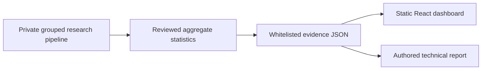

# Architecture

The original application uses static HTML and FastAPI read-only /health, /results and /leakage endpoints. The public application has no runtime dependency on it. No model, sensor record, external image or external API is shipped.
